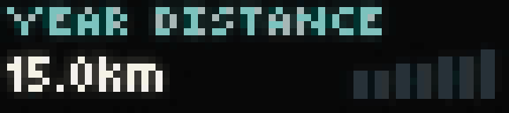

# Year Stride

Track running kilometers against your annual Garmin goal, with monthly totals and weekly distance remaining.

Choose the next week’s distance with the year’s actual runs in front of you. The total shows what you have done; the plan gap shows where that puts you on today’s share of the annual target.

## Compare distance against today’s plan

1. Set the goal in kilometers, the FIT folder and the time zone used for the year boundary.
2. Read **YEAR DISTANCE**. Its rear page gives the number of runs counted. Turn once to **PLAN GAP**.
3. A minus sign means your total is below an even distribution of the annual goal through today. The rear gives the weekly distance needed over the time remaining.



## Review the months behind the total

1. Browse beyond the plan gap to see the twelve monthly pages in order. Read the month label before comparing its distance.
2. After adding a FIT export, refresh the companion reading and return to the year total. Duplicate exports of one session count once.
3. Pin the year total with **Start** if that is the figure you want to see after each run.


## Example from the emulator

Four exports were checked. Two current-year runs totaled 15 km. A cycling activity and a run from the previous year did not add any distance. Garmin’s official decoder read the four synthetic FIT files used in the test.

## Set up the source

Use original Garmin running FIT activities. Install companion/requirements.txt in the companion's Python environment. Set folder, target_km and your IANA time zone. Cycling and prior years are excluded. The same running session exported twice counts once. Browse the gap to today's linear target and the monthly distribution. Only summaries are sent to the display.

## Connect the bar

Copy companion/example.json to a private config.json and adjust it for your source. From the project folder run `python3 companion/serve.py --config config.json`. Use Python 3.10+. Set Local companion URL to `http://127.0.0.1:8770/reading` on the emulator and allow local port 8770. On hardware, bind the companion to a trusted LAN interface and set its reachable address. The wheel browses pages. Click refreshes. Start pins or unpins the current page. The last good reading is labeled offline after a source error.

## Run in the emulator

Open BUSY Bar Emulator. From this repository, run:

```sh
~/.busy-emulator/bin/busy-emulator dev --once
```

Press **Back** to exit.

The GIFs are excerpts from the emulator recording. Each front-display pixel is shown at 9× its original width and height. The end frames pause for reading.

[Full recording](media/controls.mp4) · [Rear display](screenshots/back-1.png) · [Firmware test](EMULATOR-QA.md) · [MIT license](LICENSE)
