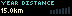

# Year Stride

Track running kilometers against your annual Garmin goal, with monthly totals and weekly distance remaining.

Use original Garmin running FIT activities. Install companion/requirements.txt in the companion's Python environment. Set folder, target_km and your IANA time zone. Cycling and prior years are excluded. The same running session exported twice counts once. Browse the gap to today's linear target and the monthly distribution. Only summaries are sent to the display.

## Connect the bar

Copy companion/example.json to a private config.json and adjust it for your source. From the project folder run `python3 companion/serve.py --config config.json`. Use Python 3.10+. Set Local companion URL to `http://127.0.0.1:8770/reading` on the emulator and allow local port 8770. On hardware, bind the companion to a trusted LAN interface and set its reachable address. The wheel browses pages. Click refreshes. Start pins or unpins the current page. The last good reading is labeled offline after a source error.

## Run locally

From this folder, run `~/.busy-emulator/bin/busy-emulator dev --once` with BUSY Bar Emulator open. Back exits.

